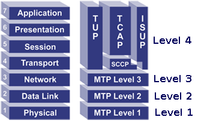

# Architecture

jSS7 is a Java implementation of the SS7 protocol stack above the transport layer. This fork, maintained by Telenity, is derived from Mobicents/RestComm jSS7 2.0.0.CR2 and keeps the SIGTRAN path only: **SCTP → M3UA → SCCP → TCAP**. Hardware MTP2/MTP3 boards, linksets, ISUP, the JBoss service wrapper and the simulator are removed.

## Contents

- [SS7 in brief](#ss7-in-brief)
- [Layers and modules](#layers-and-modules)
- [Wiring the stack](#wiring-the-stack)
- [Management](#management)
- [Persistence](#persistence)
- [Building](#building)

## SS7 in brief

SS7 (Signaling System No. 7) is the ITU-T family of protocols that telephone networks use to set up, control and tear down calls and to carry non-call-related transactions such as mobile location updates and USSD. Its levels map loosely onto the OSI model:



| SS7 level | Purpose | jSS7 |
|-----------|---------|------|
| MTP1, MTP2 | Physical and link layer over TDM | Not included; replaced by IP transport |
| MTP3 | Network layer: point codes, routing, link management | Provided over IP by **M3UA** (RFC 4666) on top of **SCTP** (RFC 4960) |
| SCCP | Global title translation, subsystem addressing, connectionless transfer | **sccp** module |
| TCAP | Transactions and dialogs between applications, ASN.1 components | **tcap** module |
| MAP, CAP, INAP | Application protocols | Built by users on top of TCAP |

## Layers and modules

```
 +-----------------------------------------+
 |  Application (MAP / CAP / your code)    |
 +-----------------------------------------+
 |  tcap        Dialogs, components, ASN.1 |   tcap-api, tcap-impl, asn
 +-----------------------------------------+
 |  sccp        GTT, routing, SCMG         |   sccp-api, sccp-impl
 +-----------------------------------------+
 |  m3ua        AS/ASP, routes, MTP3 user  |   m3ua/api, m3ua/impl  (implements mtp-api Mtp3UserPart)
 +-----------------------------------------+
 |  sctp        Netty SCTP / TCP transport |   sctp-api, sctp-impl
 +-----------------------------------------+
```

| Module | Content |
|--------|---------|
| `sctp` | `Management` API and the Netty 4 implementation `NettySctpManagementImpl`. Servers and associations; SCTP multi-homing and a TCP fallback for environments without kernel SCTP. |
| `mtp` | `Mtp3UserPart` API shared by any MTP3 provider, plus base classes. M3UA is the only provider in this fork. |
| `m3ua` | `M3UAManagementImpl` implements `Mtp3UserPart`. Application servers, ASPs, routes, the ASP/AS state machines and heartbeat. |
| `sccp` | `SccpStackImpl` with the router (rules, primary and backup addresses, service access points, destinations) and resources (remote point codes and subsystems). Connectionless classes 0 and 1, UDT / XUDT / LUDT with segmentation. |
| `asn` | ASN.1 BER encoder and decoder used by TCAP. |
| `tcap` | `TCAPStackImpl`, dialogs, invoke and result components, timers. |
| `management` | `shell-server-api`: the `ShellExecutor` interface that the `sctp`, `m3ua` and `sccp` commands implement. See the [Shell Command Reference](Chapter-Shell.md). |

Each layer exposes a provider object to the layer above and receives its transport from the layer below. Nothing is looked up through JNDI or a container; the objects are created and wired in plain Java.

## Wiring the stack

The minimal bootstrap creates the four layers bottom-up and starts them in the same order. The names given to the management objects are also the names of their persistence files.

```java
// 1. SCTP transport
NettySctpManagementImpl sctp = new NettySctpManagementImpl("sctp");
sctp.setPersistDir(persistDir);
sctp.start();

// 2. M3UA on top of SCTP; it is the MTP3 provider for SCCP
M3UAManagementImpl m3ua = new M3UAManagementImpl("m3ua");
m3ua.setPersistDir(persistDir);
m3ua.setTransportManagement(sctp);
m3ua.start();

// 3. SCCP; the id passed to setMtp3UserPart is the <mtp3-id> used by "sccp sap create"
SccpStackImpl sccp = new SccpStackImpl("sccp");
sccp.setPersistDir(persistDir);
sccp.setMtp3UserPart(1, m3ua);
sccp.start();

// 4. TCAP bound to local subsystem 8
TCAPStackImpl tcap = new TCAPStackImpl(sccp.getSccpProvider(), 8);
tcap.start();
```

Configuration of associations, application servers, routes, SCCP addresses and rules is done either through the management APIs on these objects or through the shell commands, which call the same APIs. Once persisted, the configuration is reloaded on the next `start()`.

Stop in reverse order: `tcap.stop()`, `sccp.stop()`, `m3ua.stop()`, `sctp.stop()`.

## Management

Every management object implements `ShellExecutor` from `management/shell-server-api`. A host application collects the executors and dispatches a command line to the one whose `handles(String)` accepts the first word:

```java
SCTPShellExecutor sctpExec = new SCTPShellExecutor();
sctpExec.setSctpManagement(sctp);
M3UAShellExecutor m3uaExec = new M3UAShellExecutor();
m3uaExec.setM3uaManagement(m3ua);
SccpExecutor sccpExec = new SccpExecutor();
sccpExec.setSccpStack(sccp);
List<ShellExecutor> executors = Arrays.asList(sctpExec, m3uaExec, sccpExec);

String run(String line) {
    String[] args = line.trim().split("\\s+");
    for (ShellExecutor e : executors) {
        if (e.handles(args[0])) return e.execute(args);
    }
    return "Invalid Command";
}
```

The full command set is documented in the [Shell Command Reference](Chapter-Shell.md).

## Persistence

Each management object writes its configuration as an XML file in its persist directory and reads it back on start:

| Object | File | System property for the directory |
|--------|------|-----------------------------------|
| `NettySctpManagementImpl` | `<name>_sctp.xml` | `sctp.persist.dir` |
| `M3UAManagementImpl` | `<name>_m3ua.xml` | `m3ua.persist.dir` |
| `SccpStackImpl` router | `sccprouter.xml` | `sccprouter.persist.dir` |
| `SccpStackImpl` resources | `sccpresource.xml` | `sccpresource.persist.dir` |

If `setPersistDir` is not called, each component reads its own system property from the table and falls back to `user.dir`.

## Building

Java 8 or newer and Maven 3 are required.

```
mvn install
```

runs every module's tests and installs the jars. Documentation PDFs are not part of the default build; they are produced with `mvn -Pdocs -pl docs package`.
