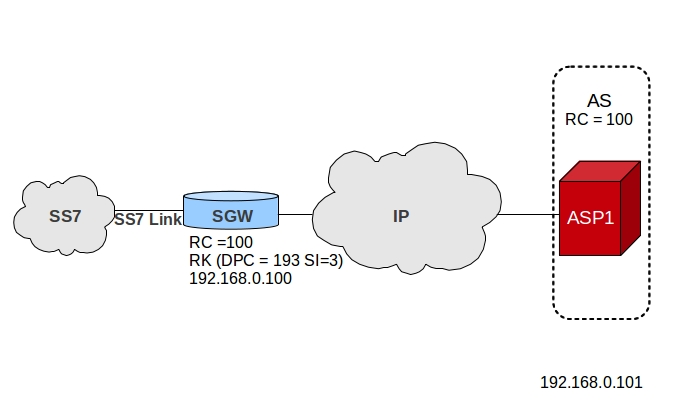
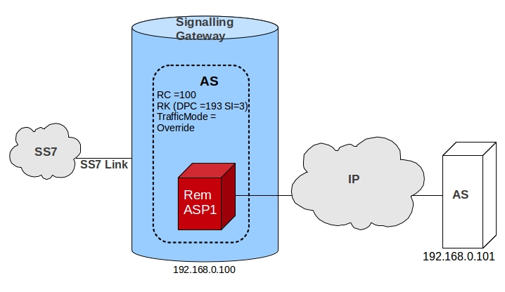
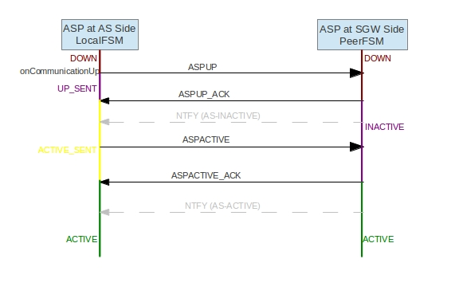
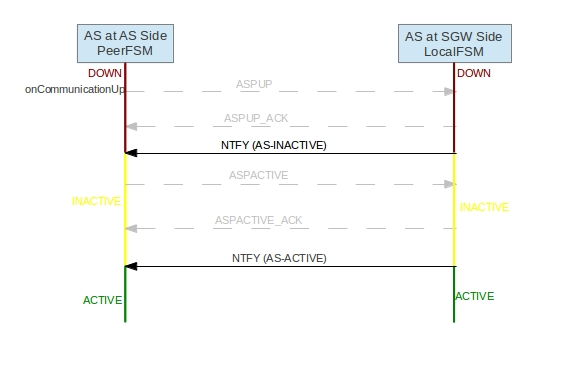
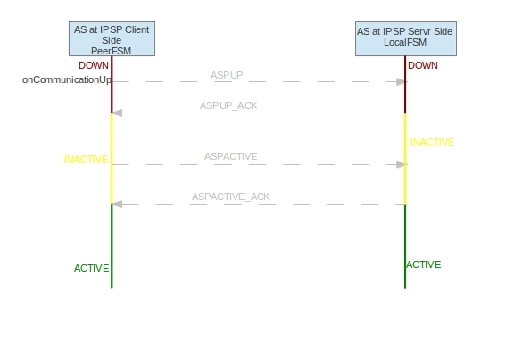

# M3UA

M3UA (MTP3 User Adaptation, RFC 4666) carries MTP3-user traffic such as SCCP over IP. jSS7's `M3UAManagementImpl` implements the `Mtp3UserPart` interface, so SCCP sees it exactly as it would see a hardware MTP3. It runs over the jSS7 SCTP module, a Netty 4 based transport that offers real SCTP with multi-homing and a TCP mode for hosts without kernel SCTP support.

## Contents

- [Roles](#roles)
- [Application servers and processes](#application-servers-and-processes)
- [Routes](#routes)
- [Load sharing](#load-sharing)
- [State machines](#state-machines)
- [Heartbeat](#heartbeat)
- [Not supported](#not-supported)

## Roles

The `functionality` given to `m3ua as create` is the role of the **local** side.

### Application Server (AS)

The stack talks to an external Signaling Gateway. The Routing Context is optional; the gateway usually assigns it.

### Signaling Gateway (SGW)

The stack accepts ASPs from application servers and interworks their traffic with the SS7 side. Routing keys are provisioned statically with `m3ua route`; there is no dynamic routing key management.

### IP Server Process (IPSP)

Two peers use M3UA point-to-point without a gateway. One side is configured `ipspType CLIENT` and initiates the SCTP association, the other `ipspType SERVER`. This is the common deployment between two IP-only nodes.

## Application servers and processes

An **AS** is a logical destination identified by a name and optionally a Routing Context. An **ASP** is a process bound to one SCTP association. ASPs are assigned to ASs with `m3ua as add`; one ASP may serve several ASs over the same association provided every AS has its own Routing Context, and all of them agree on functionality, exchange mode and IPSP type.

The **exchange mode** (`mode SE` or `DE`) decides whether ASP state and traffic maintenance messages are exchanged once (single exchange, the peer answers with ACKs) or by both sides (double exchange, each side runs its own state machine and the number of handshake messages doubles).

The **traffic mode** of an AS is `loadshare` (default), `override` or `broadcast`, and `min-asp` sets how many ASPs must be active before the AS is considered active in loadshare mode.

Starting an ASP (`m3ua asp start`) starts its association and, once the association is up, runs the ASP Up / ASP Active handshake. Stopping it sends ASP Down and closes the association.

## Routes

Outgoing MTP3 traffic is routed to an AS by destination point code (DPC), with optional originating point code (OPC) and service indicator (SI). A value of `-1` for OPC or SI is a wildcard. Lookup tries the most specific key first:

1. `dpc:opc:si`
2. `dpc:opc:-1`
3. `dpc:-1:-1`

If nothing matches, `sendMessage` throws an `IOException` (*No AS found for routing message*) to the caller, which SCCP logs; the message is not sent.

| DPC | OPC | SI | AS names |
|-----|-----|----|----------|
| 2 | 3 | 3 | AS1, AS2 |
| 2 | 3 | -1 | AS1, AS2 |
| 4 | -1 | -1 | AS3 |

Up to `maxAsForRoute` ASs (default 2, range 1 to 4, set programmatically with `setMaxAsForRoute` before `start()`; changing it once routes exist throws `IllegalStateException`) may be bound to the same key. Routes are added with `m3ua route add`, see the [Shell Command Reference](Chapter-Shell.md#add-route), section *Add Route*.

## Load sharing

Load sharing uses the SLS field of the MTP3 routing label in two stages: first to pick an AS among those bound to the route, then to pick an ASP inside that AS.

**AS selection.** A group of SLS bits selects the starting slot among the ASs of the route; if that AS is not active the next slots are tried in turn. The number of bits depends on the configured maximum ASs per route:

| Max AS for route | SLS bits used for the AS | Remaining bits for the ASP |
|------------------|--------------------------|----------------------------|
| 1 or 2 | 1 | 7, up to 128 ASPs |
| 3 or 4 | 2 | 6, up to 64 ASPs |

By default the most significant bits of the SLS pick the AS and the least significant pick the ASP. `setUseLsbForLinksetSelection(true)` swaps this, which is useful when the peer generates SLS values that vary only in the low bits.

**ASP selection.** Inside an AS in `loadshare` mode, the remaining SLS bits index the list of active ASPs. In `override` mode, the single active ASP receives everything. For an even spread, use a number of ASPs that divides the SLS space evenly, typically a power of two.

## State machines

jSS7 keeps a finite state machine per ASP and per AS. On the AS side (and IPSP client side) the ASP machine is the *local* FSM and the AS machine is the *peer* FSM; on the SGW side (and IPSP server side) it is the reverse. `m3ua as show` and `m3ua asp show` print the current states, which is the first thing to look at when a link does not come up.

ASP states with single exchange:

AS states with single exchange, AS and SGW roles:

AS states for IPSP, where no Notify messages are exchanged:

With double exchange, both a local and a peer FSM exist for each ASP and AS on each side.

The diagrams show the single-exchange happy path and match the transitions defined in `AspImpl` and `AsImpl`. States that only appear off the happy path:

| FSM | State | Meaning |
|-----|-------|---------|
| ASP local | `UP_SENT`, `ACTIVE_SENT`, `INACTIVE_SENT`, `DOWN_SENT` | A request was sent and its ACK is awaited. `UP_SENT` and `ACTIVE_SENT` retransmit the request every 2 seconds until the ACK arrives or the association drops. |
| ASP local | `INACTIVE` | Reached from `UP_SENT` when the ASP UP ACK arrives but the ASP cannot be activated, typically because it is not assigned to any AS. With an AS assigned the ASP goes straight from `UP_SENT` to `ACTIVE_SENT`, as drawn. |
| ASP peer | `INACTIVE` | The remote ASP sent ASP UP but not yet ASP ACTIVE, or sent ASP INACTIVE. |
| AS local and peer | `PENDING` | The AS was `ACTIVE` and its last active ASP went inactive or down. Outgoing payload is queued for 2 seconds; if another ASP becomes active in that time the AS returns to `ACTIVE` and the queue is flushed, otherwise the queue is cleared and the AS becomes `INACTIVE` (some ASP still up) or `DOWN` (none). |

Any drop of the SCTP association takes both ASP machines to `DOWN` immediately.

## Heartbeat

With `heartbeat true` on `m3ua asp create`, the ASP sends a BEAT message whenever no M3UA traffic has been seen for the heartbeat interval (5 seconds by default, `setHeartbeatTime`). After more than two consecutive BEATs without a BEAT ACK the association is closed and reopened, and the ASP re-runs the Up / Active handshake.

## Not supported

- **Routing Key Management** (REG REQ / DEREG REQ): received messages are answered with an error and logged. Routes must be provisioned statically.
- **Hardware MTP3** behind the gateway: this fork has no linkset or board support, so the SGW role is limited to interworking between M3UA peers.
- **Broadcast traffic mode**: accepted by the shell and the AS state machine, but not exercised by the test suite. Use `loadshare` or `override`.
